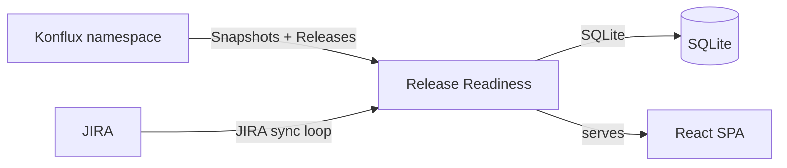

# Release Readiness Dashboard

Tracks Konflux build snapshots and releases, and JIRA issues, across Quay release versions.

## Architecture



The Go backend runs background sync loops that pull data into a local SQLite database. The React SPA is embedded into the binary and served directly by the backend.

## Syncing

### Konflux sync (default: every 30s)

Lists `Snapshot` and `Release` resources (`appstudio.redhat.com/v1alpha1`) in the `-namespace` Konflux namespace through the Kubernetes API, using `-kubeconfig`/`KUBECONFIG` or, when unset, the in-cluster service account. New snapshots are stored with their component images; releases are upserted. Each record's `created_at` is the resource's `creationTimestamp`.

### JIRA sync (default: every 5m)

Discovers active releases by querying for JIRA issues with the `-area/release` component that are not Closed/Done. Parses the version from the ticket summary (e.g. "Release Quay v3.16.2") and syncs all issues whose Target Version equals the release version (e.g. `quay-v3.16.2`).

### Prow sync (default: every 15m, only when jobs are configured)

Lists the runs of each `-prow-jobs` periodic in the public `test-platform-results-public` GCS bucket and stores each run's state, Prow link and, once the run has finished, the images its `tested-images.json` names or, for a run without one (before 2026-10-09), the quay-operator, quay, clair, quay-builder and quay-builder-qemu images of the quay-operator CSV in its `olm-csvs.yaml`, the CSVs installed on the test cluster, each only when that CSV names a single digest of it. For a finished run that did not pass and whose `tested-images.json` does not list `subscription` as missing, it also reads the `finished.json` of the target's Quay install step (`quay-deploy-aws-s3`, `-odf`, `-azure-blob` or `-gcp-gcs`) and stores whether that step failed. A finished run is read once. A job maps to a Konflux application, so every z-stream of a minor (`quay-v3.18.1`, `quay-v3.18.2`) shows the same runs. The deployment ingests the install periodics whose `quay-gather` step publishes `tested-images.json`: for 3.18, AWS (ODF, S3, S3 FIPS, arm64, OCP 4.14, OCP 5.0), Azure Blob, GCP GCS and s390x libvirt; for 3.17, AWS S3.

A run installed the operator bundle its `tested-images.json` names, that of a `quay-X-Y-quay-operator-bundle` image. An `olm-csvs.yaml` run names no bundle: it installed the release candidate's only when all five of its Quay digests equal the candidate's, and an unknown build otherwise.

### Sync status

`/api/v1/sync-status` lists as `problems` each enabled sync (`konflux`, `jira`, `art-builds`, `catalog`, `prow`) whose last pass failed or that has had no success within 3 poll intervals (at least 10 minutes); the header shows a warning icon while any exist.

## Release view

Each JIRA release maps to a Konflux application by major.minor version: fixVersion `quay-v3.16.2` maps to `quay-3-16`, and `omr-v2.0.10` to `omr-2-0`.

A Quay version's builds are its application's stream Snapshots (not ART's assemblies or `fbc-ri-*` re-releases) whose images, base image excluded, carry that version in the NVR ART build history resolved for them: `quay-quay-container-3.18.1-...` is 3.18.1. Unresolved images do not count, a build carrying two versions, as while ART switches the stream, is of none, and a build counts only if ART built no lower version after it.

`/api/v1/releases/{version}/candidate` returns the version's release `candidate`, its selected STAGE build, with its images, `stage` and the version's `prod` Release, or null with the `reason`, e.g. `no release candidate yet`, or, for a version without a build while ART's newest build whose version resolves is of a lower one, `no 3.18.2 builds yet: ART still builds 3.18.1`. Its `stage` has `staged_at`, when its own stage Release completed. With a candidate, `ci` holds the application's periodic runs since the stream first built the candidate's operator bundle, in `builds` by the build each installed: the `candidate` first, then each other `build`, named by the oldest stream build holding its bundle, newest first, with its `ci` state, then an `unknown` build. Runs that never reached the Quay install are not shown. A run whose install step failed after its Subscription was created is shown on the build it tried, with `install_failed`: by the bundle it recorded, else by the one bundle of the stream's builds that ART's record of its catalog's FBC lists, and not at all for none or several. Without a candidate, `ci` is set for a version with builds: since the stream first built a bundle of them, else since its oldest build, with no `candidate` row, and an `olm-csvs.yaml` run with a Quay operator is `unknown`. A build's `ci` state is `in` when a stage Release of an `fbc-ri-*` Snapshot holding its bundle, which feeds the catalog CI installs from, succeeded, else `failed` when one failed, else `none`, or `unknown` when the stream has no such Release. `latest_in_ci` labels the newest of the bundles of the version's builds that are `in`, null when that is the candidate's: a newer build can pair rebuilt images with an older bundle. `passed` labels the newest of them, other than the candidate's and, with a candidate, first built after the candidate's bundle, that a run in `builds` installed and passed with. `refresh` is, with a candidate, `rerun` (release-from-fbc with `passed`) when `passed` is set, else `waiting` when `latest_in_ci` is newer than the candidate, else `current`; without one, `pick` (run release-from-fbc with `passed`) when `passed` is set, else `none`. `fbc` lists, for release-from-fbc with `passed`, the `pullspecs` of its FBCs: for each operator and OCP version among the version's FBC images, the one ART built last that holds a bundle of that build, by operator, then OCP version, with each pair without one in `missing` and ART build history's search for it as its `url`. It is null without `passed`, and until ART's record of each of the version's FBC images is read. `newest` is the version's newest build with its `ci` state, when one of its images of the components the candidate holds differs from the candidate's and it is not `latest_in_ci`, or when there is no candidate, and it is not `passed`; it is null otherwise. On `/api/v1/releases/overview`, a version's `latest_build` is when the newer of its newest build and its STAGE build was created, omitted when it has neither.

`/api/v1/releases/{version}/issues` lists the version's Target Version tickets, by key.

## Running the application

### Build

```bash
# Backend
go build -o release-readiness ./cmd/release-readiness/

# Frontend
cd web && npm install && npm run build
```

### CLI flags

| Flag | Env var | Default | Description |
|------|---------|---------|-------------|
| `-addr` | — | `:8080` | Listen address |
| `-db` | — | `dashboard.db` | SQLite database path |
| `-kubeconfig` | `KUBECONFIG` | — | Kubeconfig path (empty uses the in-cluster service account) |
| `-namespace` | `KONFLUX_NAMESPACE` | `art-quay-tenant` | Konflux namespace to read Snapshots and Releases from |
| `-konflux-poll-interval` | — | `30s` | Konflux sync poll interval |
| `-konflux-ui-url` | `KONFLUX_UI_URL` | `https://konflux-ui.apps.kflux-ocp-p01.7ayg.p1.openshiftapps.com` | Konflux UI URL for links to `-namespace`'s applications, Snapshots and Releases (empty disables Konflux links) |
| `-art-build-history-url` | — | `https://art-build-history-art-build-history.apps.artc2023.pc3z.p1.openshiftapps.com` | ART build history service; component images are looked up there in the background for build links (empty disables) |
| `-jira-url` | `JIRA_URL` | `https://redhat.atlassian.net` | JIRA Cloud URL |
| `-jira-api-url` | `JIRA_API_URL` | `-jira-url` | JIRA REST API base URL; set to `https://api.atlassian.com/ex/jira/<cloudId>` for scoped API tokens |
| `-jira-email` | `JIRA_EMAIL` | — | JIRA Cloud account email for API token auth |
| `-jira-token` | `JIRA_TOKEN` | — | JIRA Cloud API token (required to enable JIRA sync) |
| `-jira-project` | `JIRA_PROJECT` | `PROJQUAY` | JIRA project key |
| `-jira-poll-interval` | — | `5m` | JIRA sync poll interval |
| `-stage-release-plan-pattern` | `STAGE_RELEASE_PLAN_PATTERN` | `^quay-advisory-stage-\d+-\d+$` | Regexp matching the Konflux ReleasePlan names whose successful Releases are image STAGE builds (empty selects no staged build) |
| `-prow-jobs` | `PROW_JOBS` | — | Periodic Prow jobs to ingest, as `job_name=konflux_application[,...]`, e.g. `periodic-ci-quay-quay-redhat-3.18-aws-ocp422-e2e-install-aws-s3-nightly=quay-3-18` |
| `-prow-interval` | — | `15m` | Prow sync poll interval |
| `-catalog-url` | — | `https://catalog.redhat.com/api/containers/v1` | Red Hat container catalog API, checked hourly in the background to mark versions shipped (empty leaves JIRA's released flag as the only shipped signal) |

### Local development

```bash
# Start backend (the kubeconfig needs read access to Snapshots and Releases in the namespace)
KUBECONFIG=<path> go run ./cmd/release-readiness -addr :8088 -db /tmp/rr.db

# In a separate terminal, start the Vite dev server (proxies /api to localhost:8088)
cd web && npm run dev
```

### Deployment

`deploy/rbac.yaml` creates the `release-readiness` ServiceAccount and a Role granting read-only access to Snapshots and Releases. The Role and RoleBinding must live in the Konflux namespace the app reads.

### Upgrading

The schema changed when the Konflux source moved to Kubernetes. Delete the old SQLite database file before upgrading; it is recreated on startup.
