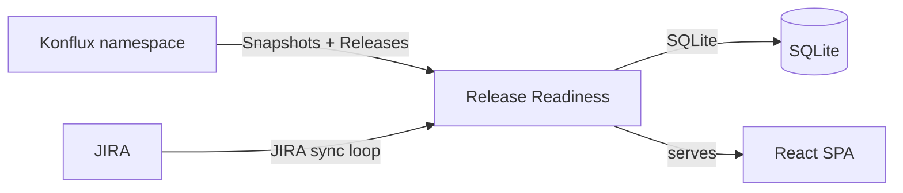

# Release Readiness Dashboard

Tracks Konflux build snapshots and releases, and JIRA issues, across Quay release versions.

## Architecture



The Go backend runs background sync loops that pull data into a local SQLite database. The React SPA is embedded into the binary and served directly by the backend.

## Syncing

### Konflux sync (default: every 30s)

Lists `Snapshot` and `Release` resources (`appstudio.redhat.com/v1alpha1`) in the `-namespace` Konflux namespace through the Kubernetes API, using `-kubeconfig`/`KUBECONFIG` or, when unset, the in-cluster service account. New snapshots are stored with their component images; releases are upserted. Each record's `created_at` is the resource's `creationTimestamp`.

### JIRA sync (default: every 5m)

Discovers active releases by querying for JIRA issues with the `-area/release` component that are not Closed/Done. Parses the version from the ticket summary (e.g. "Release Quay v3.16.2") and syncs all issues whose Target Version equals the release version (e.g. `quay-v3.16.2`).

### Prow sync (default: every 15m, only when jobs are configured)

Lists the runs of each `-prow-jobs` periodic in the public `test-platform-results-public` GCS bucket and stores each run's state, Prow link and, once the run has finished, the images its `tested-images.json` names or, for a run without one (before 2026-10-09), the quay-operator, quay, clair, quay-builder and quay-builder-qemu images of the quay-operator CSV in its `olm-csvs.yaml`, the CSVs installed on the test cluster, each only when that CSV names a single digest of it. For a finished run that did not pass and whose `tested-images.json` does not list `subscription` as missing, it also reads the `finished.json` of the target's Quay install step (`quay-deploy-aws-s3`, `-odf`, `-azure-blob` or `-gcp-gcs`) and stores whether that step failed. A finished run is read once. A job maps to a Konflux application, so every z-stream of a minor (`quay-v3.18.1`, `quay-v3.18.2`) shows the same runs. The deployment ingests the install periodics whose `quay-gather` step publishes `tested-images.json`: for 3.18, AWS (ODF, S3, S3 FIPS, arm64, OCP 4.14, OCP 5.0), Azure Blob, GCP GCS and s390x libvirt; for 3.17, AWS S3.

A run's `tested-images.json` also records the FBC catalog it installed from (`catalog.resolved_ref`); the release candidate counts a run for the FBC of that digest. An `olm-csvs.yaml` run records no catalog and counts for no FBC.

### ART build history sync (every 10m, with `-art-build-history-url`)

For each Quay stream with a stored Snapshot (ART group `quay-X.Y`), lists ART's successful FBC builds day by day: the newest 3 days every pass and up to 7 older unscanned days, back 120 days. An FBC is stored once the bundle it holds and the operator and operand images that bundle deploys are stored. A day listing at the 1000-row search cap is split by build name, the operators' FBC names and any the listing shows; a name that alone reaches the cap, or a search warning, is a sync error and the day is scanned again.

### FBC render (every 10m, with `-art-build-history-url`)

Reads up to 20 FBC images a pass anonymously from their registry (Registry v2 API): the catalogs of staged FBC Snapshots, then the newest ART FBC build of each operator, version and OCP version. It keeps, by digest, the image's `com.redhat.art.nvr` label and the head bundle of its `stable-X.Y` channel; a failed read is retried after an hour. Each head bundle is joined to its ART bundle build, read from ART build history when not yet stored.

### Sync status

`/api/v1/sync-status` lists as `problems` each enabled sync (`konflux`, `jira`, `art-builds`, `art-history`, `fbc-render`, `catalog`, `prow`, `image-scans`) whose last pass failed or that has had no success within 3 poll intervals (at least 10 minutes), and as `sources` every enabled sync with its `last_success`, null before its first success; the header shows a warning icon while any problems exist.

## Release view

Each JIRA release maps to a Konflux application by major.minor version: fixVersion `quay-v3.16.2` maps to `quay-3-16`, and `omr-v2.0.10` to `omr-2-0`.

A Quay version's builds are its application's stream Snapshots (not ART's assemblies or `fbc-ri-*` re-releases) whose images, base image excluded, carry that version in the NVR ART build history resolved for them: `quay-quay-container-3.18.1-...` is 3.18.1. Unresolved images do not count, a build carrying two versions, as while ART switches the stream, is of none, and a build counts only if ART built no lower version after it.

`/api/v1/releases/{version}/candidate` returns the version's operator FBCs up for release in `fbc_candidate`, and as its stream built them in `fbc_stream`; both are null while the version has no FBC built or staged. `fbc_candidate` takes each operator and OCP version slot's FBC from the newest FBC Snapshot ART staged for stage (`source` `stage_snapshots`), else from the newest successful ART build (`stream`). An operator's slots are the OCP versions any of its FBCs of the version was built or staged for. `operators` always holds quay-operator, container-security-operator and quay-bridge-operator, each with the `head_bundle_nvr`, `channel` and `head_csv` of its newest FBC whose head bundle is joined, its slots' FBCs on that bundle in `members` and the others in `conflicts`, the slots without an FBC in `missing_ocp`, and `coverage`. Its `fbc_ri_stage` is `in` when a stage Release holding its head bundle succeeded, an `fbc-ri-*` Snapshot's or the version's image shipment's, else `failed` when one failed, else `none`, or `unknown` without a head bundle; `image_check` compares its head bundle with that of the version's STAGE build, else its newest build: `matches`, `differs`, or `absent` when either is unknown. `stage` counts its `members` whose newest stage Release succeeded, and, on `fbc_candidate`, each FBC's `staged` counts the staged FBC Snapshots of its slot whose newest Release succeeded. `images` lists its head bundle's relatedImages, by name, from its newest-OCP member FBC that was read, each with its ART build's `nvr`, `commit` and `build_url` (its ART build page), empty for an image ART did not build, and `stage` or `prod` set when a succeeded stage or prod Release holds its digest, and its CVE `scan`, null until the scan sync reads it. `compare` compares them with its FBC's previous channel entry (`previous`) and, on `fbc_candidate`, with the stream's head bundle when that is another (`newer`); each row is `same`, `rebuild` (same commit), `new source`, `new build` (a commit unknown), `added` or `removed`. `state` is `inconsistent` when an operator's FBCs head more than one bundle, `incomplete` when an operator or slot has no FBC, `unknown` while a head bundle or a staged catalog's identity is unresolved (staged catalogs no NVR names are in `unknown`), else `complete`; `errors` names each operator missing or heading more than one bundle. `pullspecs`, release-from-fbc's fbc-pullspecs by operator, then OCP version, is empty unless `complete`. `reading` counts the shown FBCs' reads as `read`, `failed` and `pending`. `verdict.state` is `shipped` for a shipped version, whose `fbc_candidate` is the record of what shipped, with no `missing_ocp` and no `pullspecs`; else `checking` while a read is pending, `not_ready` with a blocker, or `ready`. `verdict.items` lists blockers, then warnings, then info, each with its `operator` (empty for the release), `owner` (`ART`, `ART/Konflux`, `Quay (release-from-fbc)`, `Quay/ART` or empty), `code` and `text`. Blockers: `not_staged` on a stream candidate; `missing_operator`, `missing_ocp`, `read_failed`, `no_head_bundle`, `stage_release_failed` and `unknown_fbc` on a staged one; `csv_mismatch`, `mixed_builds`, `image_mismatch` and `stage_push_failed`, when an operator's `fbc_ri_stage` is `failed`, on either; `stream_ahead` is info when the stream's newer bundle only rebuilds images, else a warning. Each FBC's `ci` lists, by job, the periodic runs that installed from its digest (`exact`) and from another FBC of its operator, OCP version and head bundle (`equivalent`). `candidate` is the version's selected STAGE build with its `prod` Release, or null with the `reason`, e.g. `no release candidate yet`, or, for a version without a build while ART's newest build whose version resolves is of a lower one, `no 3.18.2 builds yet: ART still builds 3.18.1`. `catalogs` lists the version's FBC catalogs: each of its assembly's stage FBC Snapshots, `staged`, with its `snapshot`, `pullspec`, newest `release` and `release_plan`, then, for each operator and OCP version, the newest version-matched stream catalog ART did not stage, `built`. `unshipped_builds` lists, with a candidate, the newest image of the version of each component its stage Snapshot leaves out, by component, and is null without one. On `/api/v1/releases/overview`, a version's `latest_build` is when the newer of its newest build and its STAGE build was created, omitted when it has neither.

`/api/v1/releases/{version}/issues` lists the version's Target Version tickets, by key.

`/api/v1/releases/{version}/ci` lists the version's ART FBC builds, newest first, each with its `state` (`shipped`, else `candidate`, else `staged`, else empty) and the periodic runs that installed from its catalog digest.

## Running the application

### Build

```bash
# Backend
go build -o release-readiness ./cmd/release-readiness/

# Frontend
cd web && npm install && npm run build
```

### CLI flags

| Flag | Env var | Default | Description |
|------|---------|---------|-------------|
| `-addr` | — | `:8080` | Listen address |
| `-db` | — | `dashboard.db` | SQLite database path |
| `-kubeconfig` | `KUBECONFIG` | — | Kubeconfig path (empty uses the in-cluster service account) |
| `-namespace` | `KONFLUX_NAMESPACE` | `art-quay-tenant` | Konflux namespace to read Snapshots and Releases from |
| `-konflux-poll-interval` | — | `30s` | Konflux sync poll interval |
| `-konflux-ui-url` | `KONFLUX_UI_URL` | `https://konflux-ui.apps.kflux-ocp-p01.7ayg.p1.openshiftapps.com` | Konflux UI URL for links to `-namespace`'s applications, Snapshots and Releases (empty disables Konflux links) |
| `-art-build-history-url` | — | `https://art-build-history-art-build-history.apps.artc2023.pc3z.p1.openshiftapps.com` | ART build history service; component images are looked up there in the background for build links, and FBC builds synced and rendered for the FBC candidate (empty disables all of them) |
| `-tekton-results-url` | — | `https://tekton-results-tekton-results.apps.kflux-ocp-p01.7ayg.p1.openshiftapps.com` | Tekton Results API; the CVE scans of candidate images are read there in the background with the Konflux credential (empty disables) |
| `-jira-url` | `JIRA_URL` | `https://redhat.atlassian.net` | JIRA Cloud URL |
| `-jira-api-url` | `JIRA_API_URL` | `-jira-url` | JIRA REST API base URL; set to `https://api.atlassian.com/ex/jira/<cloudId>` for scoped API tokens |
| `-jira-email` | `JIRA_EMAIL` | — | JIRA Cloud account email for API token auth |
| `-jira-token` | `JIRA_TOKEN` | — | JIRA Cloud API token (required to enable JIRA sync) |
| `-jira-project` | `JIRA_PROJECT` | `PROJQUAY` | JIRA project key |
| `-jira-poll-interval` | — | `5m` | JIRA sync poll interval |
| `-stage-release-plan-pattern` | `STAGE_RELEASE_PLAN_PATTERN` | `^quay-advisory-stage-\d+-\d+$` | Regexp matching the Konflux ReleasePlan names whose successful Releases are image STAGE builds (empty selects no staged build) |
| `-prow-jobs` | `PROW_JOBS` | — | Periodic Prow jobs to ingest, as `job_name=konflux_application[,...]`, e.g. `periodic-ci-quay-quay-redhat-3.18-aws-ocp422-e2e-install-aws-s3-nightly=quay-3-18` |
| `-prow-interval` | — | `15m` | Prow sync poll interval |
| `-retention` | — | `720h` | Age past which data no release needs is pruned daily and not ingested: Snapshots not ART staged, shipped or the newest of their application, Failed Releases not of an ART staged Snapshot, Prow runs and unreferenced image caches (0 disables) |
| `-catalog-url` | — | `https://catalog.redhat.com/api/containers/v1` | Red Hat container catalog API, checked hourly in the background to mark versions shipped (empty leaves JIRA's released flag as the only shipped signal) |

### Local development

```bash
# Start backend (the kubeconfig needs read access to Snapshots and Releases in the namespace,
# and to its Tekton Results records while -tekton-results-url is set)
KUBECONFIG=<path> go run ./cmd/release-readiness -addr :8088 -db /tmp/rr.db

# In a separate terminal, start the Vite dev server (proxies /api to localhost:8088)
cd web && npm run dev
```

### Deployment

`deploy/rbac.yaml` creates the `release-readiness` ServiceAccount and a Role granting read-only access to Snapshots and Releases, and get/list on `results.tekton.dev` results and records for the CVE scan counts. The Role and RoleBinding must live in the Konflux namespace the app reads.

### Upgrading

The schema changed when the Konflux source moved to Kubernetes. Delete the old SQLite database file before upgrading; it is recreated on startup.
